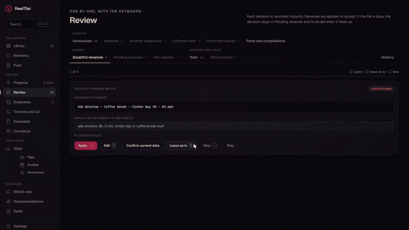
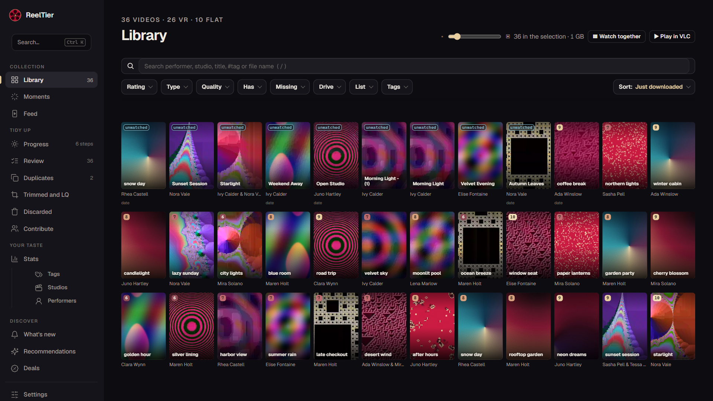
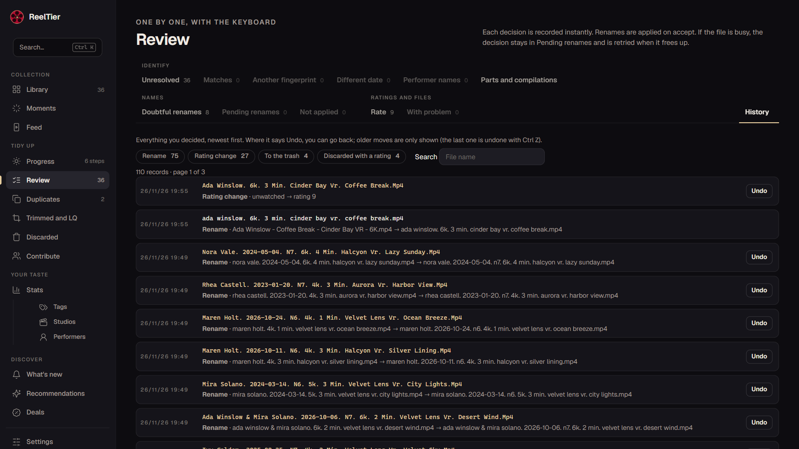
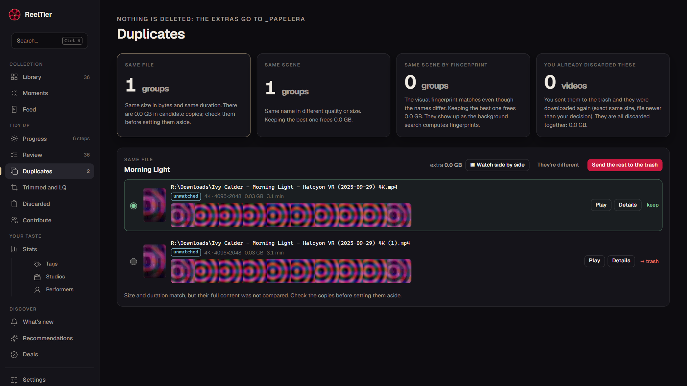
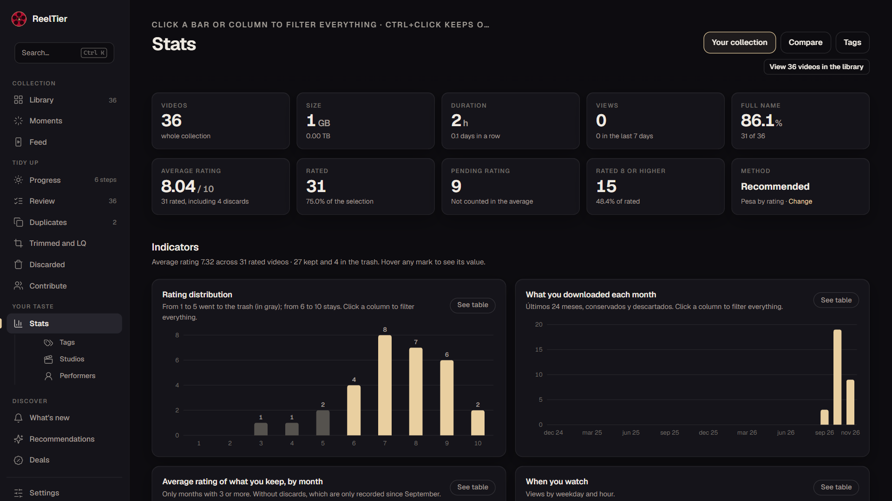
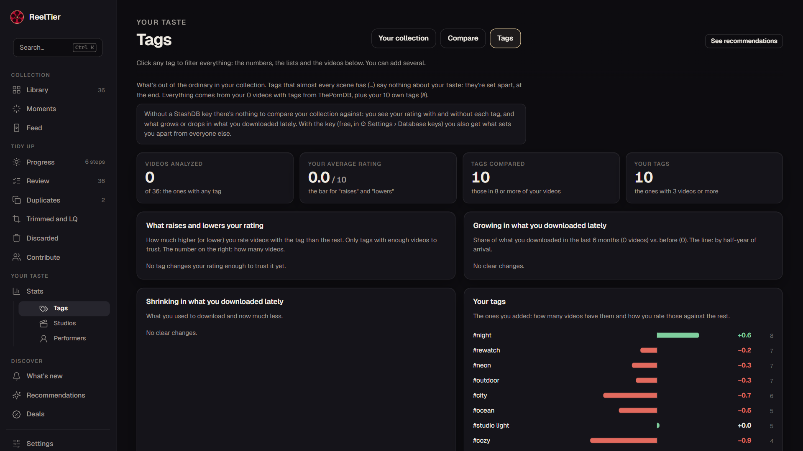
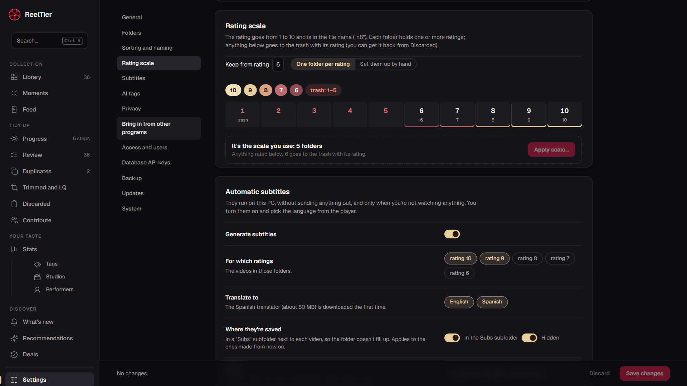

# ReelTier

**Rate it in your headset. ReelTier files it.**

ReelTier is a free, private organizer for VR and 2D adult video collections on Windows. Give a video a 1 to 10 rating from HereSphere, the headset's browser or the PC, and ReelTier moves it to the folder for that rating, renames it with performer, studio and date, and learns what you like.

> 18+ only. ReelTier organizes files you already have on your PC. This repository has no explicit content.

**[Download for Windows](https://github.com/reeltier/reeltier/releases/latest/download/ReelTier-Setup.exe)** · [Website](https://reeltier.com) · [What's new](https://reeltier.com/changelog) · [Guide](docs/GUIDE.md) · [Guía en castellano](docs/GUIA.md)



**[Watch the 1-minute demo](https://reeltier.com/#demo)** (test collection, no explicit content, no sound)

Comparisons: [ReelTier vs XBVR](https://reeltier.com/vs/xbvr) · [ReelTier vs Stash](https://reeltier.com/vs/stash) · [XBVR and Stash alternatives](https://reeltier.com/vs/xbvr-stash-alternatives) · [HereSphere vs DeoVR](https://reeltier.com/vs/heresphere-vs-deovr) · Guides: [a HereSphere library on Windows](https://reeltier.com/guides/heresphere-local-library) · [organize by rating](https://reeltier.com/guides/organize-vr-collection-by-rating) · [stream from your PC to Quest 3](https://reeltier.com/guides/stream-vr-videos-pc-to-quest-3)

## Screenshots

| | |
|---|---|
|  |  |
| Library: VR and 2D, with covers and filters | History: the rating moved and renamed the file |
|  |  |
| Duplicates: same file, same scene, same picture | Stats: click any bar and everything filters |
|  |  |
| Tags: what raises or lowers your ratings | Your own rating scale and folders |

_Screenshots from a test collection made of generated clips; names are invented._

## What it does

- **Rate once, everything follows.** By default each rating from 6 to 10 has its own folder and 1 to 5 goes to a trash folder you empty yourself. The scale is yours: keep from any rating, 2 to 6 folders, one per rating or grouped. Undo with Ctrl+Z.
- **Identifies scenes by file fingerprint** against StashDB, ThePornDB and FansDB (all optional, free keys) and fills in performers, studio, date and cover.
- **Your headset is the remote.** Native libraries for HereSphere and DeoVR with covers, previews, markers, lists and tags in sync; funscripts; DLNA for TVs, consoles and Kodi.
- **Duplicates:** identical files, the same scene in two qualities, and trimmed copies.
- **Statistics and Tags:** what sets your taste apart from what's expected, what raises or lowers your ratings, and how it changes over time. Every tag filters everything.
- **Recommendations** of scenes you don't have, each with a one-line reason ("+0.8 over your average"), plus your favorites' new releases (official sites and Pornhub) and a Deals page with current studio discounts.
- **Actress and studio pages** with the scenes you're missing.
- **Multi-user** with roles and PIN, `.nfo` export for Plex/Jellyfin/Kodi, Stash import, watermark reading, automatic subtitles.

## Privacy

Everything runs on your PC: videos, ratings, tags, history and keys never leave it. No account, no cloud, no telemetry. Scene lookups send a file fingerprint or a title, only to the databases you set up with your own key. Once a day ReelTier reads two small public files from reeltier.com (latest version and studio affiliate codes). Details: [reeltier.com/privacy](https://reeltier.com/privacy).

## Is it free?

Yes, with no limits and no ads. When ReelTier takes you to a studio's official site and that studio has an affiliate program, the link carries ReelTier's code: if you subscribe, ReelTier gets a share at no extra cost to you. It never changes what gets recommended: recommendations come only from your ratings and tags.

## Requirements

Windows 10 or 11, 64-bit. Everything it needs comes in the installer (including ffmpeg). A VR headset is optional.

## Is the installer safe?

The installer isn't code-signed yet, so Windows SmartScreen may say it's from an unknown publisher ("More info" → "Run anyway"). You can check that your copy is the published one: each release lists its SHA-256, and in PowerShell

```powershell
Get-FileHash .\ReelTier-Setup.exe -Algorithm SHA256
```

must print the same value. The app updater checks the same hash before installing an update.

## Support

Questions and ideas: [Discussions](https://github.com/reeltier/reeltier/discussions). Bugs: open an [issue](https://github.com/reeltier/reeltier/issues). Or write to info@reeltier.com.

## License

Freeware: free to download, install and use. See [LICENSE.txt](LICENSE.txt).
